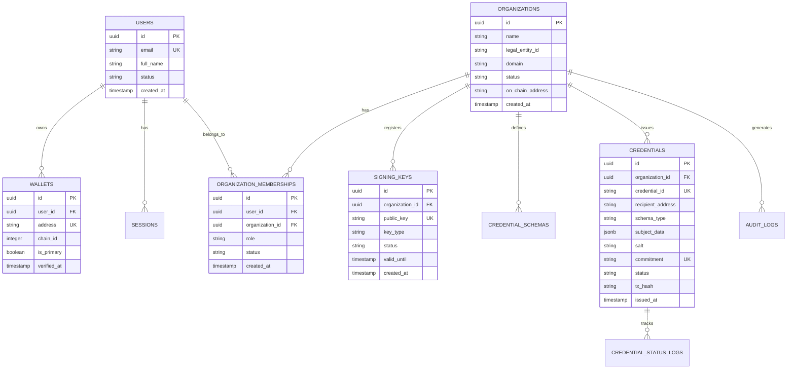

# Data Architecture Specification

**Project:** DecentralID  
**Date:** November 2026  

---

## 1. Data Classification & Privacy Matrix

To guarantee strict compliance with data privacy regulations (GDPR, FERPA) and prevent public exposure of sensitive information, data is segregated into five distinct categories:

| Category | Typical Attributes | Storage Location | Encryption / Protection |
|---|---|---|---|
| **Public Blockchain Metadata** | Issuer address, signing key, credential commitment (`bytes32`), lifecycle status (`enum`), timestamps | Ethereum / EVM Smart Contracts | Public on-chain; Zero personal data. |
| **High-Entropy Salt** | 256-bit cryptographic salt (`bytes32`) | Held by credential holder; Backend DB (Tenant-scoped) | AES-256-GCM at rest; TLS in transit. |
| **Personal Identifiable Information (PII)** | Legal name, student ID, birth date, email | Holder Device (Encrypted Wallet); Backend DB (Encrypted) | **NEVER** stored on-chain or on public IPFS. |
| **Credential Subject Attributes** | Degree name, major, GPA, honors, graduation date | Signed Credential Package (Holder Wallet); Backend DB | Encrypted in transit; Salted commitment on-chain. |
| **Operational & Audit Logs** | Event name, actor ID, IP address, user agent, timestamp | PostgreSQL `audit_logs` | Append-only; Strict RBAC; No passwords/keys. |

---

## 2. Entity-Relationship Model (PostgreSQL)

---

## 3. Privacy-Preserving Commitment Design

A critical failure of naive blockchain identity implementations is computing a simple SHA-256 hash over predictable personal fields (e.g., `hash("John Doe, Harvard 2024")`). An attacker can easily precalculate dictionary hashes and identify the holder.

DecentralID mandates **High-Entropy Salted Commitments**:

$$C = \text{keccak256}(\text{canonicalJSON}(S) \mathbin{\Vert} R)$$

Where:
- $S$ is the canonicalized credential subject claims object.
- $R$ is a 256-bit cryptographically secure pseudorandom salt generated using `os.urandom(32)`.
- $C$ is the resulting 32-byte commitment registered on `CredentialRegistry.sol`.

Only the holder (possessing $S$ and $R$) can present the credentials and prove equality with $C$. Third-party observers of the blockchain learn nothing about the subject claims.
