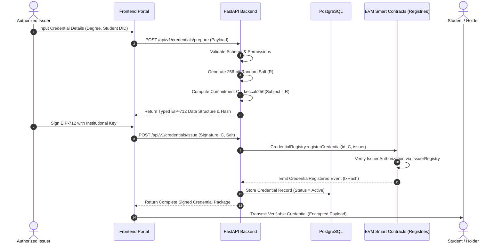
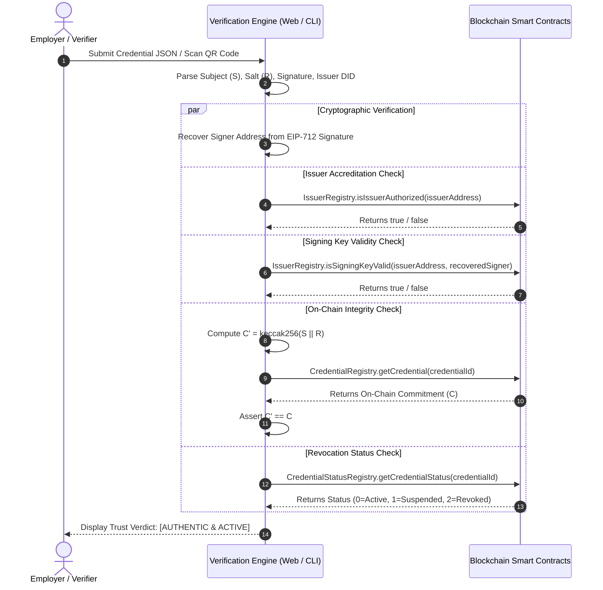

# End-to-End Data Flow Specification

**Project:** DecentralID  
**Date:** November 2026  

---

## 1. Sequence Diagram: Credential Issuance Flow

This sequence diagrams the complete interaction between the Institutional Issuer, DecentralID Backend, PostgreSQL, and Smart Contracts:

---

## 2. Sequence Diagram: Independent Credential Verification Flow

This sequence diagrams how an independent verifier verifies a credential without requiring an account or contacting the issuer:

