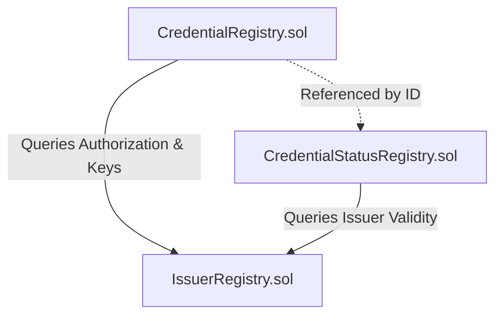

# Smart Contract Architecture Specification

**Project:** DecentralID  
**Date:** November 2026  
**Implementation Target:** Phase 4  

---

## 1. Architectural Philosophy & Decomposition

The legacy monolithic contract `IdentityReputation.sol` is superseded by three distinct, loosely coupled, interoperable registry contracts built using OpenZeppelin Contracts v5:



1. **`IssuerRegistry.sol`:** Authoritative Public Key Infrastructure (PKI) and institutional registry.
2. **`CredentialRegistry.sol`:** On-chain integrity anchor for privacy-preserving salted credential commitments.
3. **`CredentialStatusRegistry.sol`:** Cryptographic lifecycle status registry (`Active`, `Suspended`, `Revoked`).

---

## 2. Contract Specifications

### 2.1 Contract A: `IssuerRegistry.sol`
- **Core State:**
  ```solidity
  enum IssuerRole { Individual, Organization, VerifiedInstitution }
  enum IssuerStatus { Inactive, Active, Suspended, Revoked }

  struct IssuerInfo {
      string metadataURI;     // Off-chain organization profile/legal metadata
      IssuerRole role;
      IssuerStatus status;
      uint256 authorizedAt;
  }

  struct SigningKeyInfo {
      bool isActive;
      uint256 validUntil;     // Timestamp (0 = indefinite)
  }

  mapping(address => IssuerInfo) public issuers;
  mapping(address => mapping(address => SigningKeyInfo)) public issuerSigningKeys;
  ```
- **Access Control:**
  - `DEFAULT_ADMIN_ROLE`: Governance / Multi-sig account.
  - `GOVERNANCE_ROLE`: Can authorize, suspend, or revoke institutional issuers.
  - Organization admins can self-manage authorized signing keys for their own address.
- **Key Functions:**
  - `authorizeIssuer(address issuer, IssuerRole role, string calldata metadataURI)`
  - `suspendIssuer(address issuer)`
  - `reinstateIssuer(address issuer)`
  - `revokeIssuer(address issuer)` (Irreversible)
  - `registerSigningKey(address signingKey, uint256 validUntil)`
  - `revokeSigningKey(address signingKey)`
  - `isIssuerAuthorized(address issuer) external view returns (bool)`
  - `isSigningKeyValid(address issuer, address signingKey) external view returns (bool)`

---

### 2.2 Contract B: `CredentialRegistry.sol`
- **Core State:**
  ```solidity
  struct CredentialRecord {
      bytes32 commitment;      // Salted hash of credential subject
      address issuer;          // Registered institutional issuer address
      uint256 issuedAt;        // Block timestamp of registration
  }

  mapping(bytes32 => CredentialRecord) public credentials; // Keyed by credentialId
  ```
- **Key Functions:**
  - `registerCredential(bytes32 credentialId, bytes32 commitment, address issuer)`
    - Verifies `msg.sender` is either the authorized issuer or an authorized operational signing key of the issuer via `issuerRegistry.isSigningKeyValid(issuer, msg.sender)`.
    - Enforces uniqueness: Reverts if `credentials[credentialId].issuedAt != 0`.
    - Reverts if `commitment == bytes32(0)`.
    - Emits `CredentialRegistered(credentialId, commitment, issuer, block.timestamp)`.
  - `getCredential(bytes32 credentialId) external view returns (bytes32 commitment, address issuer, uint256 issuedAt)`

---

### 2.3 Contract C: `CredentialStatusRegistry.sol`
- **Core State:**
  ```solidity
  enum CredentialStatus { Active, Suspended, Revoked }

  struct StatusEntry {
      CredentialStatus status;
      uint256 updatedAt;
      string reason;          // Optional audit reason
  }

  mapping(bytes32 => StatusEntry) public credentialStatuses;
  ```
- **State Machine Transitions:**
  - `Active (0)` $\rightarrow$ `Suspended (1)` or `Revoked (2)`
  - `Suspended (1)` $\rightarrow$ `Active (0)` or `Revoked (2)`
  - `Revoked (2)` $\rightarrow$ **TERMINAL STATE** (Cannot be reinstated under any circumstance)
- **Key Functions:**
  - `suspendCredential(bytes32 credentialId, string calldata reason)`
  - `reinstateCredential(bytes32 credentialId, string calldata reason)`
  - `revokeCredential(bytes32 credentialId, string calldata reason)`
  - `getCredentialStatus(bytes32 credentialId) external view returns (CredentialStatus status, uint256 updatedAt)`

---

## 3. Gas & Optimization Strategy

1. **Fixed-Size Primitives:** Use `bytes32` for `credentialId` and `commitment` instead of dynamic strings to cut SLOAD/SSTORE gas costs.
2. **Compact Struct Packing:** Group timestamps and enums to fit in single 32-byte storage slots.
3. **No Unbounded Loops:** Avoid array iteration in state-changing and view functions.
4. **Custom Errors:** Use Solidity custom errors (`error Unauthorized()`, `error AlreadyExists()`) instead of expensive revert strings.
