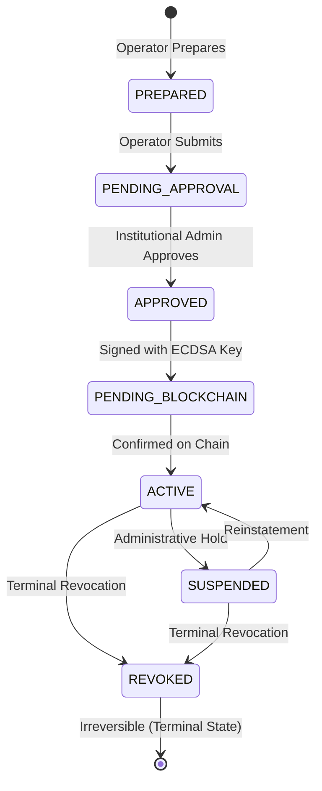

# Credential Lifecycle State Machine & Invariants

## 1. Lifecycle State Machine

DecentralID credentials transition through mathematically non-repudiable states governed by both backend services and the Ethereum smart contract `CredentialStatusRegistry.sol`.

---

## 2. Invariant Rules

1. **Terminal Revocation:** Once a credential is `REVOKED`, it can NEVER transition back to `ACTIVE` or `SUSPENDED`. Attempting to reinstate a revoked credential fails immediately with `InvalidStatusTransitionException` (HTTP 400) and reverts on-chain with `CredentialAlreadyRevoked`.
2. **Suspension vs Revocation:**
   - Suspension is a reversible temporary hold (e.g. pending student fee audit or disciplinary inquiry).
   - Revocation is permanent (e.g. fraudulent credential issuance, academic expulsion, or degree forfeiture).
3. **Renewal / Replacement:**
   - When renewing or correcting a credential, the previous credential is permanently revoked and the new credential explicitly embeds a `supersedes_id` pointing to the previous credential's on-chain identifier.
