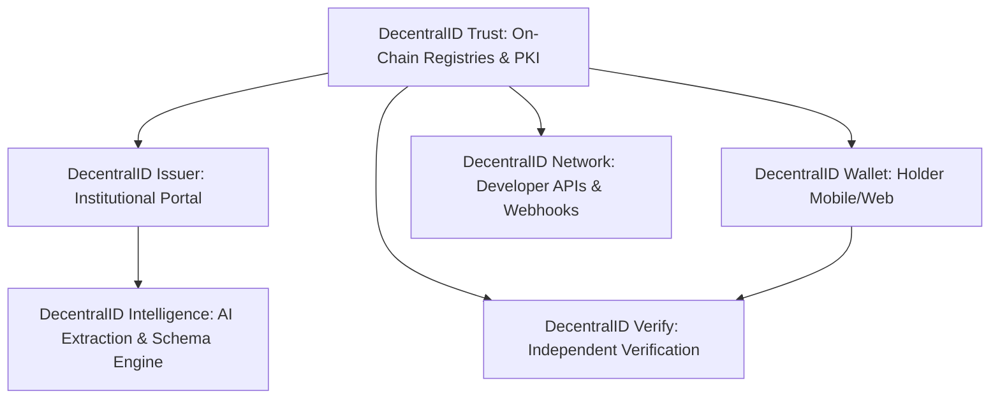

# Product Requirements Document (PRD)

**Product Name:** DecentralID  
**Initiative:** BUILD 2036 — Frontier 03: Digital Infrastructure  
**Phases Covered in Design:** Phases 0–4 (Architecture supporting future Phases 5–10)  
**Version:** 2.0.0-PROD  
**Status:** Approved Architecture  

---

## 1. Executive Summary & Vision

DecentralID transforms the paradigm of educational and professional qualification management from fragmented, paper-heavy, and easily forged credentials into a privacy-preserving, decentralized digital trust infrastructure.

Rather than relying on unverified PDF resumes, easily manipulated LinkedIn recommendations, or centralized databases vulnerable to single points of failure, DecentralID provides:
- **Institutions:** A cryptographically sound issuance portal with multi-party authorization, verifiable key management, and instant lifecycle control (issuance, suspension, revocation).
- **Holders (Students/Professionals):** Self-sovereign control over digital credentials stored locally and privately, with selective disclosure capabilities.
- **Verifiers (Employers/Universities):** Independent, sub-second verification of credential authenticity, issuer validity, and revocation status without contacting the issuing institution or exposing private data.

---

## 2. Six Interconnected Product Modules

DecentralID is architected around six core pillars:

| Module | Scope | Phase | Purpose |
|---|---|---|---|
| **DecentralID Trust** | Smart Contracts & PKI | Phase 4 | On-chain authoritative registries: `IssuerRegistry`, `CredentialRegistry`, `CredentialStatusRegistry`. |
| **DecentralID Issuer** | Institutional Portal | Phases 2–3 (Foundation), Phase 6 (UI) | Multi-tenant organization dashboard for preparing, signing, and managing credential lifecycles. |
| **DecentralID Wallet** | Personal Credential Portal | Phases 2–3 (Foundation), Phase 7 (UI) | Self-sovereign wallet for storing credentials, managing DIDs, and generating verifiable presentations. |
| **DecentralID Verify** | Public/Enterprise Verification | Phases 2–3 (Foundation), Phase 8 (UI) | Offline and online cryptographic proof verification, status checking, and audit trails. |
| **DecentralID Intelligence**| AI Extraction & Verification | Phase 10 | OCR parsing, schema matching, and anomaly detection. |
| **DecentralID Network** | External API & SDK | Phase 9 | REST, GraphQL, and webhook interfaces for third-party ATS, HRIS, and ERP systems. |

---

## 3. Product Problem Statement & Value Proposition

### 3.1 The Problem
- **Fraudulent Credentials:** Upwards of 30% of resumes contain falsified degree or credential claims. Traditional verification takes days to weeks, incurring massive administrative expense.
- **Privacy Intrusion:** Verification often requires sharing entire academic transcripts or government IDs containing sensitive personally identifiable information (PII) when only specific facts need proving.
- **Centralized Vulnerabilities:** Centralized credential platforms represent honeypots for identity theft and are subject to vendor lock-in and arbitrary shutdown.

### 3.2 Value Proposition
- **Cryptographic Trust:** Trust is rooted in digital signatures from verified public keys of accredited institutions registered on Ethereum/EVM contracts.
- **Privacy by Design:** Zero personal data is stored in plain text on-chain or on public IPFS. On-chain records consist strictly of salted cryptographic commitments and bitstring status entries.
- **Sub-Second Independent Verification:** Any verifier with the public key of the issuer registry can verify credential validity in milliseconds without requiring an API connection to the issuing school.

---

## 4. System Boundaries & Phase Scope

- **Phases 0–4 (Active Target):**
  - **Phase 0:** Audit, remediation of exposed secrets and fake hashes, baseline tests.
  - **Phase 1:** Comprehensive architecture, data flow, threat models, and interface definitions.
  - **Phase 2:** Full-stack foundation: Modernized modular React/TS frontend, FastAPI backend, PostgreSQL, Docker Compose, automated CI.
  - **Phase 3:** SIWE (EIP-4361) wallet authentication, institutional invitation/auth, RBAC, strict tenant isolation, audit logging.
  - **Phase 4:** On-chain trust infrastructure: `IssuerRegistry.sol`, `CredentialRegistry.sol`, `CredentialStatusRegistry.sol`, comprehensive test suite (unit, integration, fuzzing/invariants), reproducible deployments.
- **Phases 5+ (Future Roadmap):**
  - Complete W3C JSON-LD / Data Integrity credential signing engine.
  - Interactive holder wallet and institution portal workflows.
  - W3C Bitstring Status List 1.0 on-chain compression.
  - AI document extraction and selective-disclosure ZK proofs.
