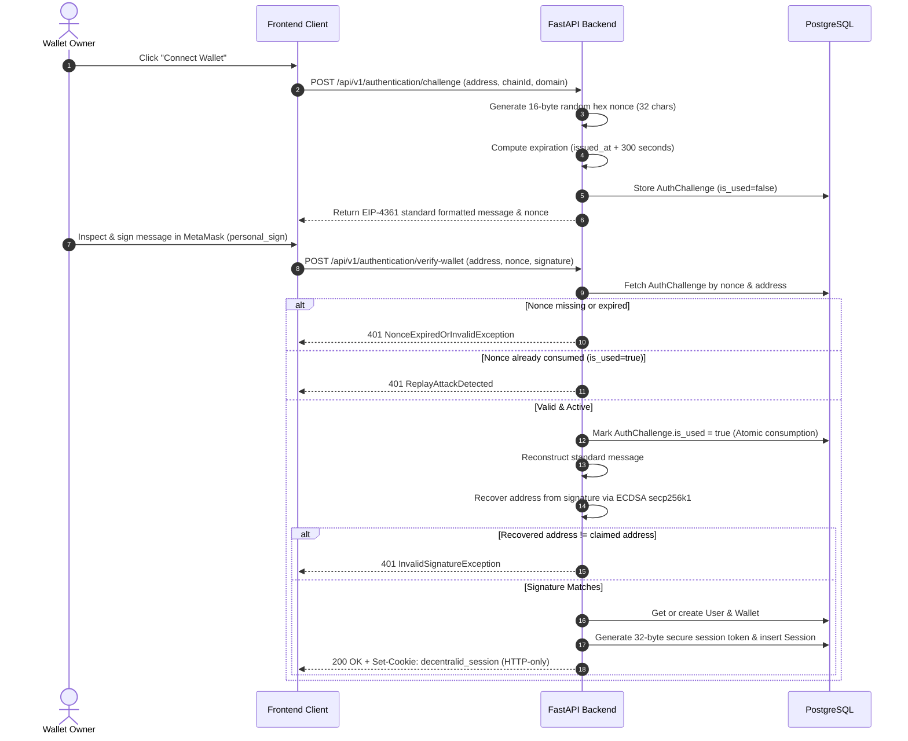

# Authentication Design Specification (EIP-4361 SIWE)

**Project:** DecentralID  
**Date:** November 2026  
**Implementation:** `backend/app/services/authentication_service.py` & `wallet_verification_service.py`  

---

## 1. Cryptographic Challenge-Response Protocol

DecentralID authenticates all individual holders and institutional operators using EIP-4361 Sign-In with Ethereum (SIWE):

---

## 2. Replay & Expiration Defenses
1. **Atomic Nonce Invalidation:** Nonces are consumed upon first evaluation. Even if an attacker intercepts a signature, resubmission results in immediate rejection (`401 Unauthorized`).
2. **Short-Lived Challenges:** Nonce time-to-live is enforced at 300 seconds (5 minutes). Stale challenges cannot be activated.
3. **Domain & URI Binding:** Messages include the host domain (`domain: localhost`) and origin URI (`uri: http://localhost:5173`), preventing phishing relay across rogue origins.
