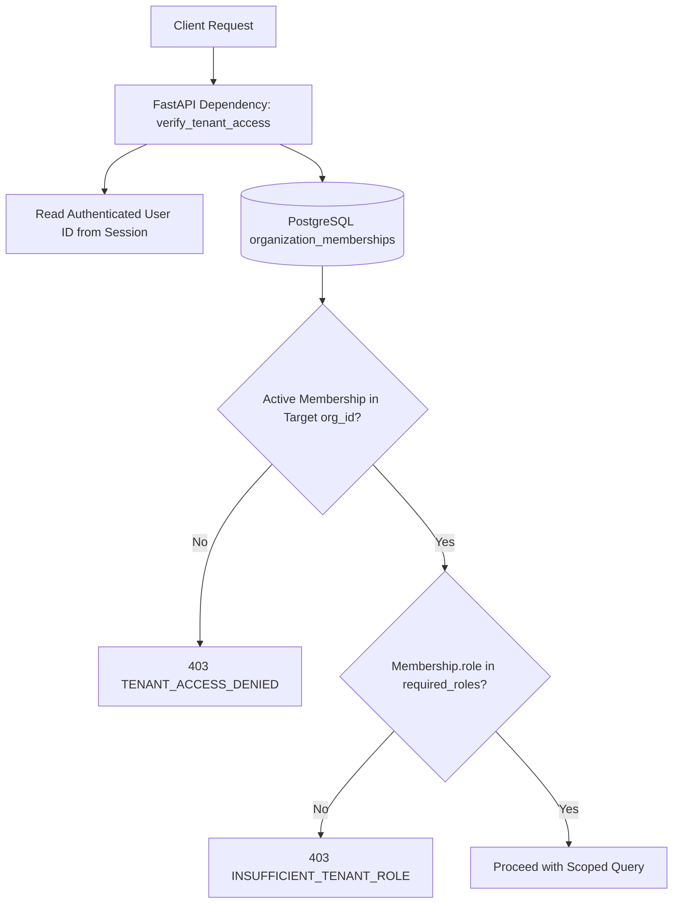

# Multi-Tenant Isolation Specification

**Project:** DecentralID  
**Date:** November 2026  
**Implementation:** `backend/app/services/authorization_service.py`  

---

## 1. The Multi-Tenancy Challenge in Institutional Infrastructure

In an educational credential system, universities and professional licensing boards are distinct organizations (tenants). A critical vulnerability in naive multi-tenant systems is **Horizontal Privilege Escalation**: an administrator from University A guessing or intercepting the `org_id` of University B and submitting queries or member invitations on University B's behalf.

DecentralID enforces **Strict Server-Side Tenant Isolation**:



---

## 2. Tenant Isolation Rules

1. **Client Organization IDs Are Untrusted:**
   The backend never assumes caller authority over a resource based on an ID passed in the request body. All operations must verify that an active row exists in `organization_memberships` matching `(user_id, organization_id)`.
2. **Tenant-Scoped SQL Queries:**
   Every database query for organization assets (signing keys, schemas, members, credentials) must append:
   ```sql
   WHERE organization_id = :authenticated_org_id
   ```
3. **Cross-Tenant Protection Tested:**
   Automated integration test `test_tenant_isolation_cross_tenant_access_rejection` verifies that an administrator from Org B attempting to inspect Org A's private data or invite members to Org A is stopped with `403 Forbidden`.
