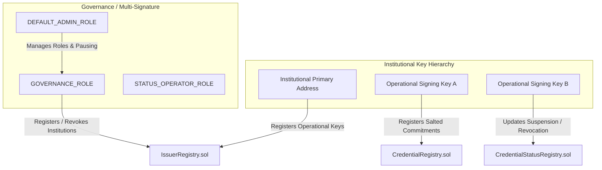

# Smart Contract Access Control Specification

**Project:** DecentralID  
**Date:** November 2026  
**Contracts:** `IssuerRegistry`, `CredentialRegistry`, `CredentialStatusRegistry`  

---

## 1. Role Hierarchy & Separation of Powers

DecentralID contracts implement OpenZeppelin v5 `AccessControl` and `Pausable` to enforce strict least-privilege boundaries:

---

## 2. Granular Contract Permissions

| Function | Contract | Required Role / Authority | Notes |
|---|---|---|---|
| `pause()` / `unpause()` | All | `DEFAULT_ADMIN_ROLE` | Circuit breaker for emergency freezing. |
| `registerIssuer()` | `IssuerRegistry` | `GOVERNANCE_ROLE` | Accredit institutional organizations. |
| `suspendIssuer()` | `IssuerRegistry` | `GOVERNANCE_ROLE` | Temporary institutional freeze. |
| `revokeIssuer()` | `IssuerRegistry` | `GOVERNANCE_ROLE` | Irreversible institutional revocation. |
| `registerSigningKey()` | `IssuerRegistry` | Active Issuer Address (`msg.sender`) | Authorize operational signing keys. |
| `revokeSigningKey()` | `IssuerRegistry` | Issuer Address or `GOVERNANCE_ROLE` | Deauthorize compromised or departed keys. |
| `registerCredential()` | `CredentialRegistry` | Authorized Issuer or Operational Key | Enforces commitment integrity & uniqueness. |
| `suspendCredential()` | `CredentialStatusRegistry` | Authorized Issuer Key or `STATUS_OPERATOR_ROLE` | Temporary suspension with reason string. |
| `reinstateCredential()` | `CredentialStatusRegistry` | Authorized Issuer Key or `STATUS_OPERATOR_ROLE` | Reinstates suspended credentials. |
| `revokeCredential()` | `CredentialStatusRegistry` | Authorized Issuer Key or `STATUS_OPERATOR_ROLE` | **Terminal Revocation:** Cannot be reactivated. |
