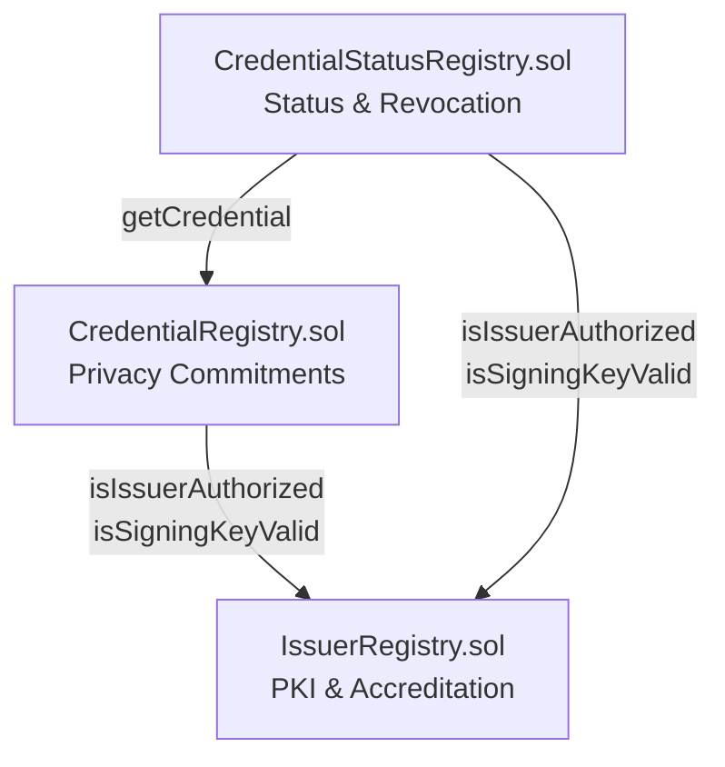

# Smart Contract Architecture & Design

**Project:** DecentralID  
**Date:** November 2026  
**Implementation:** Solidity 0.8.20 / OpenZeppelin Contracts v5  

---

## 1. Modular Trust Infrastructure

Phase 4 completes the architectural transition from the legacy prototype (`IdentityReputation.sol`) to a tri-contract verifiable credential trust infrastructure:

---

## 2. Design Principles Enforced

1. **Strict Role Separation:** Governance roles (`GOVERNANCE_ROLE`, `DEFAULT_ADMIN_ROLE`) cannot register arbitrary credentials; only accredited issuers and their authorized operational signing keys can write to `CredentialRegistry`.
2. **Fixed-Size Data Structures:** All identifiers and commitments use fixed `bytes32` hashes instead of dynamic strings, drastically reducing storage costs.
3. **No Unbounded Loops:** No contract function iterates unbounded arrays, eliminating block gas limit denial-of-service risks.
4. **Irreversible Revocation State Machine:** Credentials and institutional accreditations transitioned to `Revoked` status enter an immutable terminal state.
5. **Zero On-Chain PII:** No subject names, dates of birth, graduation marks, or transcript details are stored or emitted on-chain.
