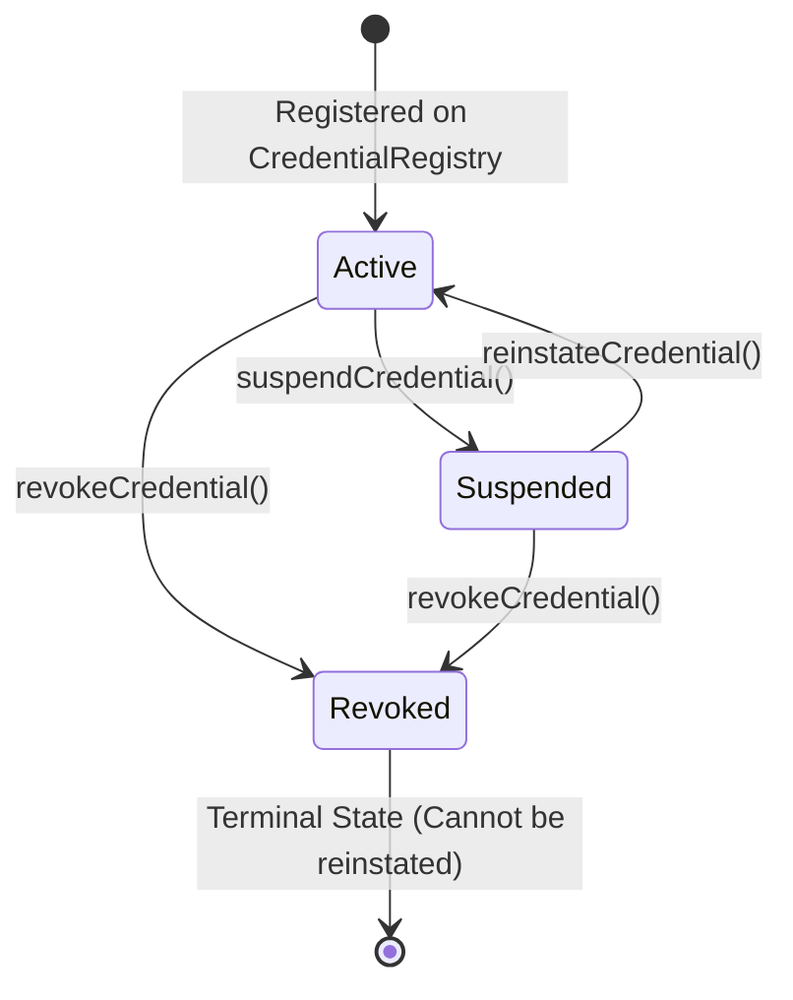

# CredentialStatusRegistry Contract Specification

**Contract:** `contracts/CredentialStatusRegistry.sol`  
**Dependencies:** `IIssuerRegistry.sol`, `ICredentialRegistry.sol`  
**Solidity:** `^0.8.20`  

---

## 1. Contract Overview
Provides a cryptographically verifiable on-chain lifecycle status registry for credentials, supporting temporary suspension and irreversible revocation.

---

## 2. State Machine Transitions

---

## 3. Function Interface

### Write Operations
- `suspendCredential(bytes32 credentialId, string calldata reason)`
- `reinstateCredential(bytes32 credentialId, string calldata reason)`
- `revokeCredential(bytes32 credentialId, string calldata reason)`

All write operations enforce the modifier `onlyAuthorizedUpdater(credentialId)`:
- Asserts credential exists on `CredentialRegistry`.
- Asserts caller is an authorized operational signing key of the credential's issuer (or holding `STATUS_OPERATOR_ROLE`).

### Read Operations
- `getCredentialStatus(bytes32 credentialId) external view returns (CredentialStatus status, uint256 updatedAt)`
  - Status `0`: `Active`
  - Status `1`: `Suspended`
  - Status `2`: `Revoked`
